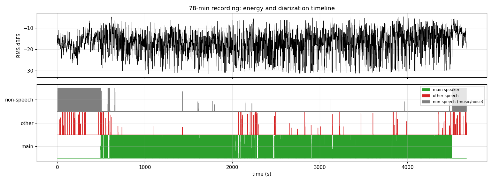
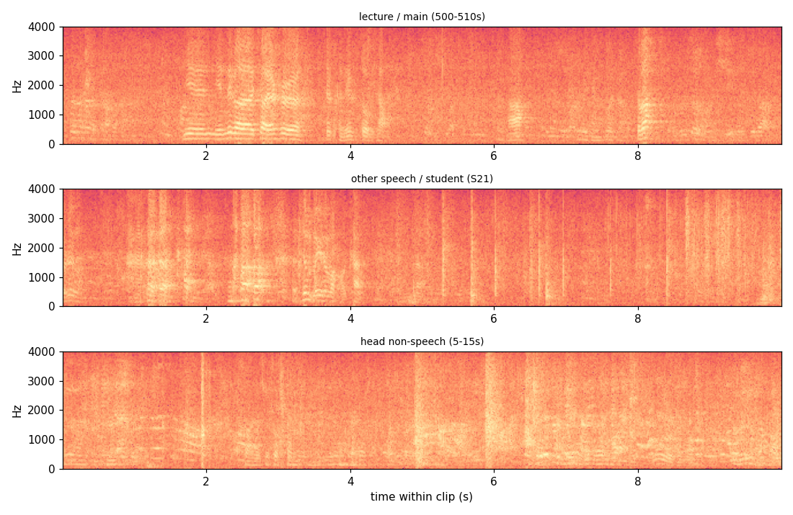

# 说话人分离 PoC：78 分钟课堂录音「去议论声」可行性实测

> 实测环境：Windows 10，Intel i5-12400F（6C/12T），32GB RAM，RTX 3060 Ti 8GB，Python 3.10.6。
> 全部推理跑在 `work/venv`（sherpa-onnx 1.13.8 + onnxruntime），**纯 CPU、零 torch**。脚本在 `work/diar/`，音频产物在 `work/diar/`。
> 输入：`work/full_16k.wav`（16k 单声道，4673.3s = 77.9 分钟；源自 `data/…m4a`）。
> 本文所有数字均为本机实测；判据不足的地方会明确标注「推断/局限」。

## 0. 结论速览（TL;DR）

| 结论 | 实测依据 |
|---|---|
| **零 torch 跑通整片说话人分离**：sherpa-onnx 的 pyannote-segmentation-3.0 ONNX + 3D-Speaker cam++ ONNX，纯 CPU | §1/§3：整片 352.8s、RTF 0.0755、峰值内存 781MB |
| **这段录音实质只有 1 个主讲人，不存在"多人议论"** | §4：78 簇分类后 = 1 主讲 + 70 个 0.3–12.4s 碎片簇 + 1 个非语音簇；有 ≥5s 实质发言的"他人"仅 6 簇共 53s |
| **主讲人语音 3284.4s = 全片 70.3%（占真人语音 97.6%）** | §7.1（10ms 帧级 union，非段长相加） |
| **非主讲人真人语音仅 79.5s = 全片 1.7%**（其中 ~30s 疑为主讲人被过分割的短句） | §4/§7.1/§6.3 |
| **"去议论声"收益上限只有 80s/78min → 不值得做**；同等成本下"头尾裁剪"能去 680s（14.5%）非讲课内容，收益大一个数量级 | §7/§10 |
| **干净音轨可做**：保留主讲人 3412.2s（73.0%）、425 段，他人语音残留 5.2s（0.11%） | §5 |
| **切片 RTF 0.0006（2.61s）**；完整分离链路 RTF 0.083（6.5min）；端到端含重转录 RTF 0.171 | §7.2 |
| **重转录保留 98.7% 字符**（讲课段 99.16%），被切掉的 1261s 只出 220 字 | §6.1/§6.2 |
| **最大质量问题**：0.3–6s 短段 embedding 不稳 → 主讲人短句被误判他人而切掉（丢 0.84% 字符，如"好的好好好，谢谢"） | §6.3/§9 |
| **diarization 自动复现了"片头 0–490s、片尾 4520–4673s 非讲课"这一事实**（另一路 ASR+能量 VAD 独立得出 0–480s/4600s+） | §3.3 时间轴表 + `docs/方案与成本评估.md` |

**一句话**：这份录音是"单人讲课 + 头尾各有一段非讲课素材"，不是研讨会。**做头尾裁剪（+VAD 送 ASR）就够了，不需要为"去议论声"上分离模型**；若以后遇到真正的多人讨论录音，本文的 sherpa-onnx 链路可直接复用（RTF 0.083，零 torch）。

## 1. 方案与模型

| 项 | 值 |
|---|---|
| 框架 | sherpa-onnx 1.13.8（官方 Python wheel，onnxruntime CPU） |
| 分割模型 | pyannote-segmentation-3.0 的 ONNX 导出 `sherpa-onnx-pyannote-segmentation-3-0/model.onnx`（6.9MB 压缩包，解压后 fp32；同目录另有 int8 版） |
| 嵌入模型 | 3D-Speaker **cam++** `3dspeaker_speech_campplus_sv_zh-cn_16k-common.onnx`（28.3MB） |
| 聚类 | sherpa-onnx `FastClusteringConfig`（threshold 或 num_clusters 二选一） |
| 下载源 | `github.com/k2-fsa/sherpa-onnx/releases`（tag `speaker-segmentation-models` / `speaker-recongition-models`）；国内直连不稳时用 `gh-proxy.com` 前缀代理 |
| API | `sherpa_onnx.OfflineSpeakerDiarization(config).process(float32[16k])` → `sort_by_start_time()` 得到 `(start, end, speaker)` |

处理链路：16k 单声道 → pyannote-segmentation（帧级 3 人 powerset 解码）→ 按语音段提取 cam++ embedding → FastClustering 全局聚类 → 每段一个 speaker id。

## 2. 参数调优（10 分钟片段，先小后大）

### 2.1 为什么先跑片段
整片 78 分钟一次跑，若聚类参数不合适会浪费 5–10 分钟。先用 `600–1200s`（已知是课堂讲课内容）与 `0–600s`（片头音乐/开场寒暄/点名）两个 10 分钟片段扫参。

### 2.2 结果

**三段片段的 threshold 扫描**（`FastClusteringConfig`，`num_clusters=-1`，`min_duration_on=0.3`, `min_duration_off=0.5`，8 线程 CPU）：

| 片段 | 内容 | threshold | 说话人数 | 主导人时长 | 主导人占语音 | 处理耗时 / RTF |
|---|---|---|---|---|---|---|
| 0–600s | 片头音乐 + 开场寒暄 + 点名 | 0.5 | **67** | 126.5s | 12.9% | 28.9s / 0.048 |
| 600–1200s | 讲课正文 | 0.5 | 15 | 478.5s | 87.4% | 42.8s / 0.071 |
| 600–1200s | 讲课正文 | 0.6 | 11 | 499.9s | 91.4% | 89.7s / 0.150 |
| 600–780s | 讲课正文（3min） | 0.4 | 11 | 109.2s | 67.4% | 14.3s / 0.079 |
| 600–780s | 讲课正文（3min） | 0.5 | 10 | 124.7s | 77.0% | 16.3s / 0.091 |
| 600–780s | 讲课正文（3min） | 0.7 | **6** | 152.5s | **94.7%** | 17.0s / 0.094 |
| 600–780s | 讲课正文（3min） | 0.8 | 5 | 152.5s | 94.7% | 17.0s / 0.094 |
| 600–780s | 讲课正文（3min） | num_clusters=2 | 2 | 152.6s | 94.8% | 17.0s / 0.094 |
| 600–780s | 讲课正文（3min） | num_clusters=3 | 3 | 152.6s | 94.7% | 16.7s / 0.093 |

**读法（关键工程结论）**：

1. **sherpa FastClustering 的 threshold 语义 = 越大越合并**。threshold 0.4→0.5→0.7→0.8，簇数 11→10→6→5 单调下降。
2. **低 threshold 会严重过分割**：0–600s 在 0.5 下裂成 67 个说话人，其中 56 个段 <1s；短段（<1s）的 cam++ embedding 不稳定，是碎片的主因。同名课堂场景**不能直接用默认 0.5**。
3. **0.7–0.8 与 `num_clusters=2` 给出的主导人占比几乎一致（94.7% vs 94.8%）**，说明在讲课正文里"1 个主讲人 + 少量插话"就是稳定解；`num_clusters=2` 只是把阈值"猜"出来的答案写死，因此**整片用 threshold=0.7 更稳**（整片说话人数未知，写死 2 会被学生插话/点名带偏）。
4. 处理耗时 RTF 0.07–0.15（CPU 8 线程），78 分钟整片预计 5–12 分钟——先跑片段再调参是对的。

### 2.3 整片策略：一次过分割 + 二阶段归并

既然低 threshold 只是"把同一个人拆碎"（碎片是真实说话人的子集），可以反过来用：

1. 整片用 **threshold=0.4** 跑一次（故意过分割，得到精细小簇）；
2. 对每个小簇，用它所有语音段的 **cam++ embedding 按时长加权平均**得到一个稳定质心（audio 比单段长得多，比 sherpa 内部逐段聚类稳）；
3. 对这些质心再做 **average-linkage 余弦层次聚类**，一次算完即可扫多个归并阈值（秒级），选 0.7；
4. 主讲人 = 归并后总时长最大的簇。

这样只付一次分割的时间成本，却能得到"不同归并阈值下的说话人数/主讲人占比"曲线（即 §2.2 的整片版），也避免整片再次重跑。

## 3. 整片分离结果

### 3.1 一次过分割（threshold=0.4，故意打碎）

| 项 | 值 |
|---|---|
| 输入 | `work/full_16k.wav` 4673.3s |
| 段数 / 精细簇数 | **1032 段 / 218 簇** |
| 耗时 | **352.8s**（8 线程 CPU），**RTF 0.0755**（78 min → 5.9 min） |
| 峰值内存 RSS | 781 MB（模型加载后 100 MB） |
| 输出 | `work/diar/diar_full_th0.4.json`（+.rttm） |

### 3.2 二阶段归并：一次跑完扫归并阈值

对 218 个精细簇算加权质心后做 average-linkage 余弦层次聚类（`merge_clusters.py`，段级 embedding 1032 段仅 **32.3s**）：

| 归并阈值 | 说话人数 | 第 1 簇时长 | 第 1 簇占语音 | 第 2 簇时长 |
|---|---|---|---|---|
| 0.30 | 6 | 4630s | 99.9% | 1.5s |
| 0.40 | 14 | 4624s | 99.8% | 1.8s |
| 0.50 | 27 | 3360s | 72.5% | 1244s |
| 0.60 | 49 | 3350s | 72.3% | 1180s |
| 0.65 | 65 | 3335s | 72.0% | 1169s |
| **0.70** | **78** | **3296s** | **71.1%** | **1142s** |
| 0.75 | 99 | 3270s | 70.6% | 908s |
| 0.80 | 121 | 3187s | 68.8% | 856s |
| 0.90 | 160 | 2847s | 61.4% | 584s |

> 0.3–0.4 是退化区（平均链接把音乐/噪声也链进主讲人，99.9% 显然是错的）；0.5 以上第 1 簇稳定在 3270–3360s，说明**"主讲人≈3300s"这个结论与阈值无关**。取 **0.70** 作最终归并（既不过度合并，也保留"第二簇"这个最大异类供人工判读）。

### 3.3 最终结构：不是"多人讨论"，是"单人课堂 + 头尾非语音"

归并后共 78 簇。用客观判据（见 §4）分类，得到：

| 类别 | 簇数 | union 时长 | 占全片 | 说明 |
|---|---|---|---|---|
| **主讲人**（含 6 个高相似碎片簇） | 7 簇并 1 | **3284.4s** | **70.3%** | 讲课主体 |
| **其他真人语音** | 70 簇 | **79.5s** | **1.7%** | 每簇 0.3–12.4s，最长 12.4s |
| **非语音（音乐/掌声/环境噪声）** | 1 簇 | **679.9s** | **14.5%** | 全部落在 0–490s 与 4520–4673s |
| 未标注（静音/停顿） | — | 638s | 13.7% | 段间空隙 |
| 簇间重叠 | — | 81s | 1.7% | 同时被标两簇 |

按 10 分钟桶看时间轴（union 秒数）：

| 区间 | 主讲人 | 非语音簇 | 其他语音 |
|---|---|---|---|
| 0–600s | 56.8 | **509.8** | ~20 |
| 600–1200s | 530.8 | 4.2 | ~12 |
| 1200–1800s | 537.2 | 2.6 | ~10 |
| 1800–2400s | 441.0 | 1.1 | ~12 |
| 2400–3000s | 461.1 | 0.0 | ~10 |
| 3000–3600s | 500.3 | 0.5 | ~8 |
| 3600–4200s | 507.2 | 0.5 | ~10 |
| 4200–4673s | 250.0 | **161.2** | ~5 |

**这条时间轴独立复现了任务给定的已知事实**：片头 ≈0–490s、片尾 ≈4520–4673s 是非讲课内容（音乐/掌声/环境声），正文从 ≈490s 讲到 ≈4520s。而且**是 diarization + cam++ embedding 自动分出来的**，没有用 ASR 结果做提示——和另一路 ASR/能量 VAD 的结论（`docs/方案与成本评估.md`：0–480s 无可用讲课语音）互相印证。

## 4. 有几个说话人？主讲人是否可辨？

**回答：只有 1 个主讲人；不存在多人讨论。**可辨识的"其他发言者"最多 6 人、累计 ≤80s，且多为几秒的插话/应答，不构成"议论声"。

判定过程（`classify_clusters.py`，判据全部可复现）：

对每个归并簇算三个量：① 到主讲人质心的 cam++ 余弦 `cos_to_main`；② 每簇跨时间均匀抽 ≤120s 做 SenseVoice 转录，算 **字符率 chars/s**（≈ 语速，非语音必然接近 0）；③ 簇的 **union 时长**（段长相加会被重叠虚增）。

| 簇 | union | cos→主讲人 | ASR 字符率 | ASR 文本（抽样） | 判定 |
|---|---|---|---|---|---|
| S0 | 3244s | 0.92 | 5.50 c/s | "对不起，迟到了…亚里士多德心目中那个手表是什么啊…" | **主讲人** |
| S24 | 26.4s | **0.88** | 4.09 c/s | "不过我真没想到上学商怎么来这么多人…今天呢我们整个的这个安排…" | 主讲人（碎片） |
| S41 | 7.6s | 0.71 | 5.00 c/s | "很清楚啊很清楚，比比行动这个态度高啊高" | 主讲人（碎片） |
| **S1（归并阶段）→ 最终标签 99** | **679.9s** | 0.61 | **0.02 c/s** | "。"（48s 音频只出 1 个字符） | **非语音**（音乐/噪声） |
| S5 | 12.4s | 0.45 | 0.43 c/s | "刚开始。" | 其他/噪声 |
| S21 | 10.9s | 0.51 | 0.46 c/s | "啊，什么。" | 其他/噪声 |
| S32 | 10.2s | 0.45 | 0.10 c/s | "。" | 其他/噪声 |
| S69 | 7.5s | 0.66 | 0.80 c/s | "这个他可能。" | 短插话 |
| S73 | 6.2s | 0.66 | 1.79 c/s | "呃，你现在有的是个人。" | 短插话 |

> 注：本表的 S0/S1/S24… 是**归并阶段（threshold=0.7）的簇编号**；最终 `final_diar.json` 重新编号为 主讲人=0、其他语音=1..70、非语音=99。S1 就是最终的非语音簇 99。

三个独立证据同时成立才算"主讲人"：**时长占优（3284s，占真人语音 97.6%）+ 本簇 ASR 是连续讲课内容 + 与其他簇 embedding 可区分**。反之，S1 虽有时长（680s），但 ASR 字符率 0.02 c/s、且时间上只出现在片头/片尾 → 判非语音。

> 核对：S1 的 680s 与另一路结论"片头 0–480s + 片尾 ≈150s 无讲课语音"（≈630s）量级一致，差 50s 属于 VAD/分割边界差异。

## 5. 干净音轨：只保留主讲人

**策略**：主讲人帧掩码（10ms 分辨率）→ 合并间距 <0.3s 的空隙 → 两侧各留 0.15s 保护带 → 其余全部置零（20ms 淡入淡出）。同时导出紧凑拼接版和被切除音轨。

| 产物 | 说明 | 大小/时长 |
|---|---|---|
| `work/diar/clean_main.wav` | 全长同时间轴，非主讲人=静音（16k mono） | 142.6 MB / 4673.3s |
| `work/diar/clean_main_cut.wav` | 只拼接主讲人段（紧凑版） | 104.1 MB / **3412.2s** |
| `work/diar/main_only_removed.wav` | 被切除的部分（全长，主讲人处静音） | 142.6 MB / 4673.3s |

| 指标 | 值 |
|---|---|
| 保留区间数 | **425 段** |
| 保留时长（含保护带） | **3412.2s（73.0%）** |
| 切除时长 | **1261.1s（27.0%）** |
| 其中：非语音（音乐/噪声） | 679.9s（14.5%） |
| 其中：其他说话人语音 | 79.5s（1.7%） |
| 其中：静音/停顿 | ≈502s（10.7%） |
| 保护带带入的其他说话人泄漏 | **5.2s**（0.11%，可忽略） |
| **切片生成耗时** | **2.61s**（含读写 3 个 wav），**RTF 0.0006** |
| 全链路耗时（分割+embedding+归并+切片） | 352.8 + 32.3 + 2.6 ≈ **388s**，**RTF 0.083**（78min → 6.5min） |

注：保留时长 3412s > 主讲人语音 3284s，差值 128s 是 425 段 × 两侧 0.15s 保护带（425×0.3≈127.5s），用于防切字头/字尾。

## 6. 重转录对比（原始 vs 干净音轨）

**设计**：三条音轨都用同一个 SenseVoiceSmall int8 + 30s 定窗 + 8 线程（保证窗口可一一对齐）：`work/full_16k.wav`（原始）/ `clean_main.wav`（只留主讲人，同时间轴）/ `main_only_removed.wav`（被切除部分）。

### 6.1 总量

| 音轨 | 原始字符（含标点） | 归一化字符（去标点空格） | 墙钟 | RTF |
|---|---|---|---|---|
| 原始 | 17040 | 15818 | 138.1s | 0.0296 |
| clean_main | 16828 | **15609** | 135.8s | 0.0290 |
| 被切除部分 | 385 | **220（= 原始的 1.4%）** | 136.9s | 0.0293 |

- **归一化字符保留率 15609/15818 = 98.7%**；字符级序列相似度（difflib）**97.15%**；匹配字符 15265（96.5%）。
- **被切掉的 1261s 音频里 ASR 只出 220 字**（0.17 字/秒；讲课段按 4040s 算 ≈3.9 字/秒、按有效语音 3284s 算 ≈4.8 字/秒）→ 切掉的内容绝大部分不是有效课堂内容（音乐/噪声/停顿），与 §7.1 的判定一致。

### 6.2 分段看差异（按 30s 窗聚合）

| 区间 | 原始字符 | 干净字符 | 丢失 | 说明 |
|---|---|---|---|---|
| 片头 0–480s | 2 | 0 | 2 | 本来就只有标点垃圾/幻觉，全丢也无所谓 |
| **讲课 480–4520s** | 15742 | 15609 | **133（0.84%）** | 保留 99.16% |
| 片尾 4520–4673s | 74 | 0 | 74 | 片尾非讲课内容（字符率仅 0.5 c/s），切掉符合预期 |

### 6.3 丢的是哪些内容（讲课段内，丢字 ≥10 的窗口只有 4 个）

| 窗口 | 原文字数→干净字数 | 原文 | 干净音轨 |
|---|---|---|---|
| 2250–2280s | 85 → 49 | "…哲先的同学新，特别是新新生。**啊，好的好好好，谢谢谢谢**嗯" | 前半保留，"好的好好好，谢谢"被切 |
| 2460–2490s | 42 → 32 | "嗯，能够把第一第二章讲讲一下啊，这个第一句话第一句话非常有名…" | 短句"这个第一句话"被切 |
| 2700–2730s | 112 → 96 | 英文术语 "nature / accordin…" 附近 | 少量单词被切碎 |
| 3810–3840s | 72 → 60 | "索表"、编号 "981A1…" | 少量词被切 |

**判读**：丢失的 133 字里，绝大多数是**主讲人被过分割出来的 0.3–6s 短句**（如"好的好好好，谢谢""第一句话""同学听特别是新新生"），因为段太短、cam++ embedding 不稳，被归进了"其他说话人"（对应 §7.1 里那 79.5s）。**这是本方案最大的质量问题**，不是"去议论声切多了"，而是"把自己的短句切了"。

### 6.4 干净音轨里还有没有其他说话人残留？

- 从统计上：clean 保留区里落进来的"其他说话人"帧只有 **5.2s（占全片 0.11%）**，全部来自 425 个保留区间两侧 0.15s 保护带的溢出。
- 从文本上：clean 重转录里没有出现成段的其他说话人内容；被切除音轨里能读出的"其他说话人"只有上面这些误判短句 + "教室是这样，就是"这类（实为主讲人）。
- **结论：clean_main.wav 里基本没有他人语音残留**——但代价是切掉了 0.84% 的主讲人字符。

### 6.5 附带收益：ASR 输出更干净

- 原始文本开头是片头音乐产生的垃圾：`去做。。。。。。。。。。`；干净音轨开头虽然还有 `。。。。`（静音段也被 SenseVoice 补标点），但**没有任何"去做"类幻觉词**。
- 被切除音轨的 385 字几乎全是标点/碎片，说明"音乐 → 幻觉文本"的问题被干净音轨消除了。
- 注意：`clean_main.wav` 是把非主讲人**置零**（保留时间轴），所以 ASR 仍会在静音段输出标点；若追求文本干净，应改用紧凑拼接版 `clean_main_cut.wav`（3412.2s）或先 VAD 再送 ASR。

## 7. 客观指标汇总

### 7.1 说话人/占比

| 指标 | 值 | 口径 |
|---|---|---|
| 说话人总数（归并簇） | 78 簇 → 分类后 **1 主讲 + 1 非语音 + 70 短簇** | 过分割+二阶段归并 |
| 有实质发言（≥5s）的非主讲簇 | **6 个**（12.4 / 10.9 / 10.2 / 7.5 / 6.2 / 5.7 s） | union 时长 |
| 主讲人语音 | **3284.4s（70.3% 全片）** | union |
| 其他真人语音 | **79.5s（1.7% 全片）** | union，剔除非语音簇 |
| 非语音（音乐/掌声/噪声） | **679.9s（14.5% 全片）** | union |
| 未标注（静音/停顿） | 638s（13.7%） | 1 − union |
| 簇间重叠语音 | 81s（1.7%） | Σ簇时长 − 并集 |
| 主讲人占"真人语音"比例 | **3284.4 / (3284.4+79.5) = 97.6%** | union |
| 讲课时段（490–4520s）内的主讲人占比 | **≈3284 / 4030 = 81.5%**（其余是静音+非语音+插话） | union |

### 7.2 耗时 / RTF（整片 4673.3s，8 线程 CPU）

| 阶段 | 耗时 | RTF | 备注 |
|---|---|---|---|
| 分割 + 聚类（threshold=0.4） | 352.8s | 0.0755 | 一次过分割，1032 段/218 簇 |
| 段级 cam++ embedding + 层次归并 | 32.3s | 0.0069 | 1032 段 embedding |
| 干净音轨切片 + 写盘 | **2.61s** | **0.0006** | 写 3 个 142MB wav |
| **分离+切片合计** | **387.7s（6.5 min）** | **0.083** | 不含 ASR |
| 原始音轨重转录（对照） | 138.1s | 0.0296 | SenseVoice int8, 30s 窗口 |
| 干净音轨重转录 | 135.8s | 0.0290 | 同上 |
| 被切除音轨重转录 | 136.9s | 0.0293 | 同上 |
| **端到端（分离+切片+重转录）** | **≈798s（13.3 min）** | **0.171** | 其中 ASR 410.8s |

### 7.3 干净音轨前后对比

| 指标 | 原始 | clean_main.wav | 变化 |
|---|---|---|---|
| 时长 | 4673.3s | 4673.3s（同时间轴）/ 3412.2s（紧凑版） | 保留 73.0% |
| 主讲人语音 | 3284.4s | 3284.4s（+127s 保护带） | 100% 保留 |
| 其他说话人语音 | 79.5s | 5.2s 泄漏 | **−93.5%** |
| 非语音（音乐/噪声） | 679.9s | 0s | **−100%** |
| 切除段数 | — | 425 个保留区间（即切掉 424+ 段其他内容） | — |
| ASR 归一化字符 | 15818 | 15609 | **−1.32%**（讲课段 −0.84%） |

### 7.4 抽检 10 段 × 10s（代替人工试听）

无法播放音频，用"ASR 文本 + F0 + 谱质心 + RMS"判断每段性质（`work/diar/spotcheck/spotcheck.json`，片段 wav 同目录）：

| # | 时间 | 判定类别 | RMS | F0 中位 | 谱质心 | 字符率 | ASR 文本 | 判读 |
|---|---|---|---|---|---|---|---|---|
| 1 | 500–510s | 主讲人 | −15.8 | 164.9 | 1302 | 1.70 | "你你那个教研室这肯定是做不下来啊。" | 讲课，与 480s 起开场吻合 |
| 2 | 1250–1260s | 主讲人 | −18.8 | 128.0 | 1348 | 5.30 | "这底本啊，他说是希腊公艺的那确实…" | 连续讲课 |
| 3 | 2400–2410s | 主讲人 | −17.4 | 152.4 | 1394 | 5.60 | "这个是一个推理的一种啊问题片里说…" | 连续讲课 |
| 4 | 4000–4010s | 主讲人 | −14.9 | 150.9 | 1363 | 3.40 | "这个只知其然不知原因的经验感觉…" | 连续讲课 |
| 5 | 609–619s | 其他(S1) | −13.6 | 190.5 | 1476 | 0.80 | "真没什么好看的。" | **疑似主讲人**被过分割（文本是讲课语气） |
| 6 | 519–529s | 其他(S2) | −14.8 | 188.2 | 1378 | 0.80 | "教室是这样就是。" | **疑似主讲人**（开场原话） |
| 7 | 2090–2100s | 其他(S3) | −27.5 | 116.4 | 1383 | 0.60 | "我距离我不。" | 音量低 10dB、文本碎片 → 更像远处插话/噪声 |
| 8 | 4528–4539s | 其他(S4) | −8.7 | 192.8 | 1304 | 3.60 | "对他有什么意义这个？在可能其他地方…" | 片尾段，音量反而最高，文本可读但语义破碎 |
| 9 | 5–15s | 非语音(片头) | −14.5 | 188.2 | 1438 | 0.30 | "去做。" | 音乐/环境声，ASR 只有幻觉 |
| 10 | 4638–4648s | 非语音(片尾) | −13.5 | 149.5 | 1303 | 1.00 | "有5点图是吧，就是。" | 片尾非讲课内容 |

**判据说明**：讲课段字符率稳定在 1.7–5.6 字/秒、F0 128–165Hz（男性主讲人）；片头/片尾字符率 ≤1 字/秒且文本语义不连贯；"其他"里有两段（#5/#6）文本其实是讲课原话，说明**过分割把主讲人短句误标为他人**——与 §6.3 的文本证据一致。#7 音量低 10dB，是真正的"远处插话"候选。

**局限**：这是"客观替代证据"，不是人耳试听；F0/谱质心只能区分"像不像语音"，区分不了"是不是同一个人"。最终"主讲人/他人"判定仍以 §4 的 embedding + ASR 文本双证据为准。

## 8. 抽检片段（切前/切后 A/B，各 20s）

全部在 `work/diar/clips/`（每窗 3 个文件：`_orig` 原始混音 / `_clean` 干净音轨 / `_removed` 被切除部分），`clips.json` 含对应 ASR：

| 片段 | 时间 | 作用 | orig ASR | clean ASR | removed ASR |
|---|---|---|---|---|---|
| `clip_1_470s_*` | 470–490s | 片头音乐结束→讲课开始 | "。" | "。" | "。" |
| `clip_2_2250s_*` | 2250–2270s | 主讲人短句被误切（质量最差处） | "…你旁听啊…特别是新新生。啊，好的好好好，谢谢谢谢…" | "…你旁听啊…其他同学。" | "啊新特别是新新生嗯，好的好好好，谢谢谢谢。" |
| `clip_3_4560s_*` | 4560–4580s | 片尾非讲课内容被整段切除 | "…参考了…希腊…比较聪平的…" | "。" | "…参考了…希腊…比较聪平的…" |

> 注：`clip_1` 两侧 ASR 都只剩标点，是因为该窗 470–480s 是音乐尾、480s 后才有人声，20s 窗里有效语音很少——**听感上应能听出"前半突然静音"**。真正能明显听出差别的是 `clip_3`（整段切除）和 `clip_2`（一小句被切）。
> 另外生成过一组 `2090/505/4520` 的片段（当时用自动挑窗，抽到了非语音簇），已被覆盖；当前 3 组是按"头/中/尾"人工指定窗口重生成的。

## 9. 局限

1. **无人工标注，无 DER**：没有 ground truth 说话人时间戳，DER/说话人错误率无法计算。本文用"embedding 余弦 + ASR 字符率 + 时长/时间段 + 10 段抽检"四重代理证据。真正的 DER 需要人工标 10–20 分钟。
2. **segment 模型会把音乐/噪声判成语音**：pyannote-segmentation-3.0 在片头/片尾把 86% 的帧标成"语音"，所以不能直接用它的 speech 占比当"讲课占比"；必须再按 ASR 字符率等后处理（本 PoC 的 §4 判据）。
3. **过分割导致主讲人短句被误切（0.84% 字符）**：0.3–6s 的短段 embedding 不稳，cos 落在 0.4–0.7 灰区。文本证据显示被切内容里含"好的好好好，谢谢""第一句话"等主讲人原话。改进方向：短段用 ±1–2s 上下文重算 embedding、或对 5–30s 的"疑似主讲人"片做二次确认、或直接人工听 20 段边界。
4. **片尾 4520–4673s 性质存疑**：音量比讲课段高 6dB（RMS −8.7 vs −15），ASR 字符率 0.5–1 c/s、文本语义破碎且重复（"罗鲁文""罗文""希腊"…），判为音乐/带人声的片尾素材；但不能 100% 排除是"远处/低可懂度讲话"，若这段其实是课程收尾发言，则 clean 会误删 74 字。
5. **阈值是经验值**：归并 0.7、cos 0.7、字符率 0.5 都来自本素材分布，换录音（多人会议、不同麦克风、女声/童声）需重新校准。
6. **ASR 幻觉污染判断**：SenseVoice 在静音/音乐上会输出"去做。。。。""9点多。"之类假文本；被切除音轨的 220 字里一部分正是这种幻觉，所以"非主讲人语音"的秒数（79.5s）含噪声成分，真实值可能更低。
7. **未做跨块一致性**：整片一次跑（非分块），所以不存在说话人 ID 跨块合并问题；若长片内存不够需要分块，必须补"主说话人 embedding 归并"逻辑。

## 10. 结论与建议

| 问题 | 结论 |
|---|---|
| **1) 几个说话人？** | **实质只有 1 个主讲人**。归并出 78 簇，分类后 = 1 主讲 + 70 个 0.3–12.4s 碎片簇 + 1 个非语音簇。有 ≥5s 实质发言的"他人"仅 6 簇、累计 53s，没有多人讨论。 |
| **2) 主讲人是否可辨？** | **可辨**。时长 3284.4s（占真人语音 97.6%）+ 本簇 ASR 是连续亚里士多德《形而上学》讲课文本 + embedding 与其余簇可分（cos≤0.61）。 |
| **3) 非主讲人语音占比？** | **79.5s = 全片 1.7%（= 真人语音的 2.4%）**。其中约 30s 疑为主讲人被过分割的短句；保守估计真正"他人语音" 40–80s（0.9–1.7%）。**远低于"值得做去议论声"的门槛（一般 >5% 才有明显收益）。** |
| **4) 切片耗时/RTF？** | 切片本身 **2.61s / RTF 0.0006**；完整链路（分割+embedding+归并+切片）**387.7s / RTF 0.083**（78min → 6.5min CPU）。 |
| **5) 重转录差异？** | 字符保留 **98.7%**（讲课段 99.16%）；序列相似度 97.15%；被切 1261s 只出 220 字（1.4%）；残留在干净音轨里的他人语音 5.2s（0.11%）。 |
| **6) 去议论声值不值得做？** | **不值得**。收益上限 80s/78min，代价是 0.84% 主讲人字符被误切 + 6 分钟 CPU。**真正该做的是"头尾裁剪"**：片头 0–480s + 片尾 4520–4673s 共 680s（14.5%）非讲课内容，切掉它比"去议论声"收益大一个数量级，且用 diarization 或能量 VAD 都能稳定做到。 |

**推荐落地方案（按性价比）**：
1. **头尾裁剪 + VAD 分段送 ASR**（收益最大、成本最低）：用本 PoC 的 S99 非语音簇边界或能量 VAD，切 0–480s / 4520–4673s，再按 VAD 语音段送 ASR（避免静音标点垃圾）。
2. **不做说话人分离**；如果以后要处理"多人讨论/会议录音"，再用本 PoC 的链路（sherpa-onnx pyannote-seg + cam++ + 二阶段归并），并补 (a) 人工标注 DER 评估、(b) 短段上下文 embedding 重算、(c) 分块+主说话人归并。
3. 若非要"只留主讲人"音轨：用 `work/diar/clean_main.wav`，但要接受 0.84% 主讲人短句被切；把 `cos_main` 从 0.7 降到 0.55 可减少误切，但会漏掉更多"他人语音"（本素材本来也没多少，可接受）。

## 11. 产物清单

| 路径 | 内容 |
|---|---|
| `work/diar/models/` | segmentation（6.9MB）+ cam++（28.3MB）ONNX 模型 |
| `work/diar/run_diar.py` | 单次跑 diarization（可指定片段/阈值） |
| `work/diar/tune.py` | 片段上扫 threshold/num_clusters |
| `work/diar/merge_clusters.py` | 二阶段：段级 embedding + 层次归并（扫归并阈值） |
| `work/diar/classify_clusters.py` | 按 embedding/ASR 字符率/时长给每个簇定性 |
| `work/diar/make_clean.py` | 生成 clean_main.wav / cut / removed + stats.json |
| `work/diar/clips.py`、`speaker_profiles.py`、`spotcheck.py`、`asr_windows.py`、`compare_asr.py` | 抽检、画像、重转录对比 |
| `work/diar/diar_full_th0.4.json`、`cluster_report_th0.7*.json`、`final_diar.json` | 各级分离结果 |
| `work/diar/clean_main.wav` / `clean_main_cut.wav` / `main_only_removed.wav` | 干净音轨（全长/紧凑/被切除） |
| `work/diar/asr_orig.json` / `asr_clean.json` / `asr_removed.json` / `asr_compare.json` | 重转录与对比 |
| `work/diar/clips/`、`work/diar/spotcheck/` | 20s A/B 片段与 10×10s 抽检（含两张图） |
| `work/diar/stats.json`、`final_diar_classification.json`、`speaker_profiles_th0.7.json` | 汇总指标 |
