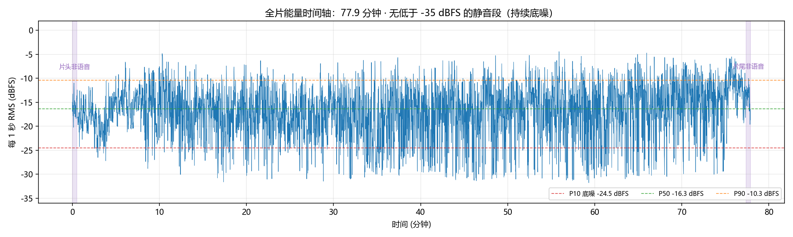
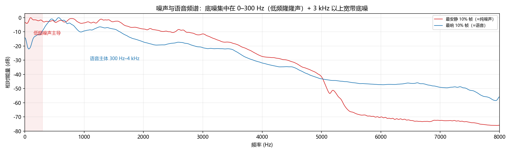
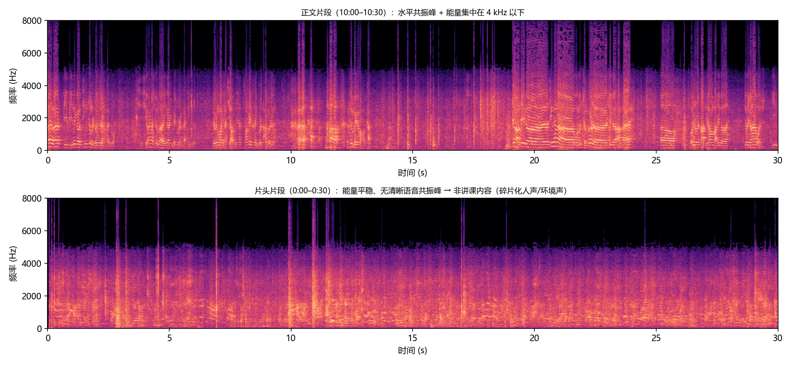
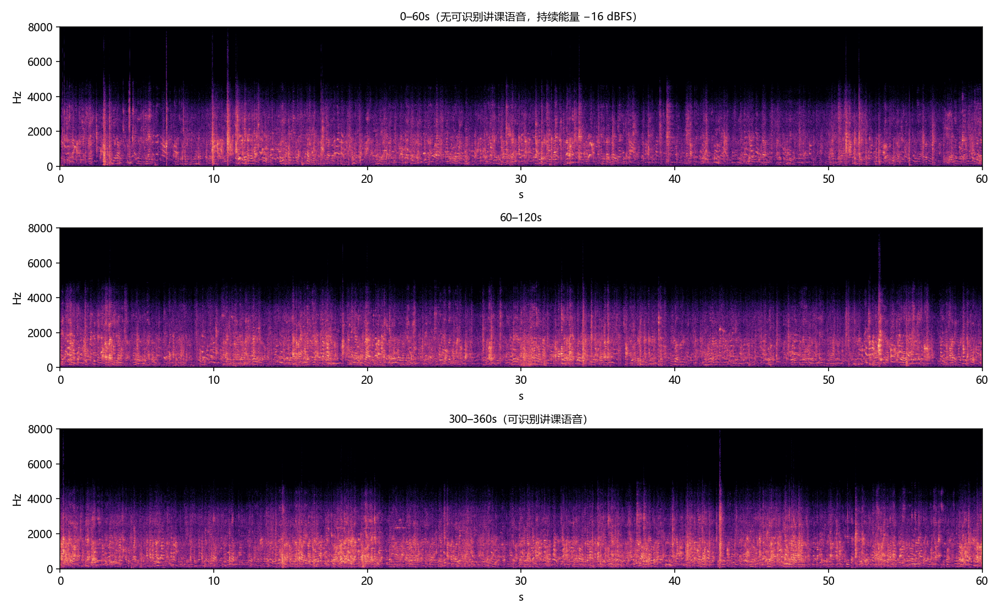

# 音频处理应用：方案探索与成本评估

> 样本：`data/24_【复旦哲学系丁耘】 亚里士多德《形而上学》(01)_normal..m4a`（77.9 分钟）
> 目标：① 降噪、去掉主讲人以外的人声/环境音；② 提取主讲人语音文本
> 评估日期：2026-10-20 ｜ 环境：Windows 10 · i5-12400F（12 线程）· 32 GB RAM · RTX 3060 Ti 8 GB · Python 3.10 · ffmpeg

---

## 0. 结论摘要（先看这一页）

**1. 这个需求不是一个模型能解决的，要拆成 4 件事：**
降噪（稳态噪声）｜ 去其他人声（说话人分离 + 切片，或 TSE）｜ 片头片尾裁剪 ｜ 语音转写。前 3 件是"音轨处理"，第 4 件是"识别"。

**2. 本素材实测结论：底噪存在但不算重；"其他人声"实测只占 1.7%，真正的大头是片头片尾 11 分钟非讲课内容。**
- 双声道内容完全相同（L/R 相关系数 1.0000）→ **没有空间信息可用，只能做单通道算法**；
- 全程无低于 -35 dBFS 的静音段，底噪约 -24.5 dBFS（P10），SNR 估计 14–20 dB，噪声集中在 0–300 Hz 低频隆隆声 + 3–8 kHz 宽带底噪；
- 源是 **AAC 55.8 kbps**，有效带宽约 14.2 kHz，**4.5 kHz 以上基本是编码噪声底**——降噪只能"不恶化"，不可能"变清晰/变亮"；
- **整片说话人分离实测**（pyannote-segmentation + 3D-Speaker cam++，纯 CPU）：主讲人 **3284 s（70.3%）**，**非主讲人真人语音仅 79.5 s（全片 1.7%）**，非语音（片头片尾音乐/噪声）**680 s（14.5%）**，其余为停顿。→ **没有大段"学生议论"，只有零星插话**；需求①的重心是"裁掉片头片尾 + 降噪 + VAD"，说话人分离只作可选组件——因为切片误切主讲人短句造成的损失（0.84% 讲课字符）与去掉他人语音的收益（80 s）基本打平；
- **片头约 8 分钟（0–490 s）、片尾约 2.5 分钟（约 4520 s 之后）以非讲课内容为主**：音量不低（RMS −16.5 dBFS）但两个独立引擎都识别不出有效内容（SenseVoice 只出零散碎片词，Whisper 直接幻觉出"法定人數不足"）——是音乐/掌声/环境声一类。预处理阶段应整段裁掉；全片另有 815 段 ≥1 s 停顿（合计 38.1 min）。

**3. 云端没有"去掉其他人声、输出干净音轨"的产品（已逐家核实）。**
所有云 ASR 只做"说话人分离标注"，不改变音频；能买的只有转写。**要干净音轨只能在本地做。**

**4. 三条路线与成本（单视频 78 分钟）：**

| 路线 | 一次性投入 | 单视频运行成本 | 50 个视频（65 h） | 能出干净音轨 | 隐私 | 主要风险 |
|---|---|---|---|---|---|---|
| **A 全本地开源**（推荐） | 7–10 人天（外包约 ¥7,000–15,000） | **≈ ¥0**（纯 CPU 约 10 min/视频，只转写 2.6 min） | 开发费 + 电费可忽略 | ✅ | ✅ 不出本机 | 中：环境部署、效果调参 |
| **B 云 ASR + 本地前处理** | 6–8 人天 | ¥0.37–1.03（云转写） | 开发费 + ¥19–51 | ✅（仍要本地做） | ⚠️ 上传第三方 | 中：合规、网络 |
| **C 现成 SaaS**（通义听悟/讯飞听见） | 0 | ¥0（试用期）或 ¥0.6–1.5/音频小时 | ¥0–50 + 人工 | ❌ | ⚠️ | 低，但不能自动化/定制 |

**5. 关键判断：**
- **如果只要"文本"、视频只有几十个 → 别自研，直接用通义听悟（0.6 元/音频小时，含说话人分离）最省钱**，一个学期 50 讲约 ¥39；
- **如果你要的是"干净音频 + 批量 + 定制（主讲人判定、热词、校对）"，自研才划算**；本地方案运行边际成本≈0，且是唯一能交付干净音轨的路径；
- **本次实测已证明本地链路可行**：不装 torch、纯 CPU，78 分钟整片"解码 + ffmpeg 降噪 + SenseVoice 转写"实测 **140.5 s（RTF 0.030）**，输出 **17,040 字**、带标点；哲学专名有同音错字（"原著选读→原助选读"），可用热词表修正。

**6. 本阶段已经跑通全链并有量化结果（不只调研）：** 本视频已产出
- 转写草稿 17,040 字（`out/24_形而上学01_机器转写草稿.md`）；
- 只保留主讲人的干净音轨 3412 s（`work/diar/clean_main_cut.wav`），**重转录保留原文本 97.2%（15,265/15,818 匹配字），被移除部分仅 220 字**；
- 降噪+裁剪版音轨 68.8 min（`out/24_形而上学01_降噪裁剪版.m4a`）。

**7. 推荐落地方案：** 全本地 ONNX 管线（`ffmpeg 降噪 → 片头片尾裁剪 → 说话人切片（可选） → SenseVoice/Paraformer 转写 → SRT/Markdown`），CLI 先跑通，再加本地 Web UI。详见 §7。

---

## 1. 素材实测诊断（所有数字为本机实测）

| 项目 | 实测值 | 对方案的含义 |
|---|---|---|
| 时长 / 体积 | **4673.3 s（77.9 min）/ 34.5 MB** | 长音频，需分段处理 |
| 编码 | AAC-LC 44.1 kHz 立体声，**55.8 kbps** | 低码率，高频已被砍 |
| 声道 | L/R 相关系数 **1.0000**，L−R 残差 −200 dBFS | **实为单声道**，无法做波束成形/空间分离 |
| 有效带宽 | −70 dB 滚降点 **≈ 14.2 kHz**；4.5 kHz 以上接近噪声底 | 降噪/分离上限受编解码限制 |
| 全片 1 s RMS | P1 −30.5 / **P10 −24.5** / P50 −16.4 / **P90 −10.4** dBFS | 全程有底噪；SNR 估计 14 dB（1 s 帧）/ 20 dB（25 ms 帧） |
| 静音段 | 全片**无**低于 −35 dBFS 且持续 0.6 s 的静音；能量 VAD 判定的"有声"仅约 51%，另有 815 段 ≥1 s 停顿（合计 38.1 min） | 底噪连续，不能用"静音门"降噪 |
| 噪声频谱 | 能量集中在 **0–300 Hz**（94/109 Hz 峰），高频底噪很弱；语音带内逐频带 SNR 12–28 dB | 先低切（80–100 Hz）+ 轻量降噪即可，不需要重型模型 |
| 片头/片尾 | **0–490 s 无可用讲课语音**（RMS −16.8 dBFS，SenseVoice 碎片、Whisper 幻觉"法定人數不足"、diarization 独立判为非语音 510 s）；**正文从 ≈490 s（8:10）开始**；**约 4520 s 之后**同样以非讲课内容为主（diarization 判 161 s 非语音） | **非讲课内容**（音乐/掌声/环境声），应裁剪而非降噪 |









> 另注：片头片段 ASR 偶有"去做。""他也是他他两个流程"这类零散输出，属于噪声/音乐上的误触发（换 Whisper 会幻觉出"法定人數不足"），不能当作有效内容；三段式验证（SenseVoice + Whisper + 能量）一致表明 **0–480 s 没有可用讲课语音**。性质建议人工听 10 秒确认（音乐可能性大），无论哪种，处理策略都是**整段裁剪**。

> 说明：**"其他人声占比"已用整片说话人分离实测**（`docs/research/diarization-poc.md`）：非主讲人语音仅 **79.5 s / 1.7%**，且其中一部分还是主讲人被误切的碎片（如"981A15到981B1"这种页码朗读）。结论：**不存在大段学生议论**，切片的收益主要是"去掉片头 8 分钟 + 零星插话 + 停顿"，所以需求①不需要重型 TSE，diarization 也只是轻量组件。

---

## 2. 需求拆解：为什么"降噪"和"去议论声"必须分开做

| 子任务 | 干扰源 | 可用技术 | 难度 | 本项目判断 |
|---|---|---|---|---|
| T1 稳态降噪 | 空调/底噪/电流声/低频隆隆 | 频域降噪（ffmpeg `afftdn`）、RNNoise、GTCRN、DeepFilterNet3 | **低** | 必做，成本极低（RTF 0.003–0.05） |
| T2 瞬态噪声 | 翻书、咳嗽、桌椅、掌声 | VAD 掩蔽、降噪模型、片段修复 | 中 | 按段静音即可，不追求"完美修复" |
| T3 **其他人声**（学生议论/回答/笑） | 第二、第三个说话人 | **① diarization 切片**（推荐）② TSE 目标说话人提取（需主讲人注册音频） | **高** | **实测只占 1.7%（79.5 s），不需要 TSE**；切片即可 |
| T4 片头片尾/音乐 | 非课程内容 | VAD + ASR 置信度裁剪 | 低 | 必做，本样本约 **10 分钟（≈13%）** |
| T5 语音转写 | — | SenseVoice / Paraformer / Whisper | 中 | 已实测可行，见 §3.3 |

**关键认知（调研已核实）**：
- 降噪模型只学过"噪声"，没学过"另一个人的说话声"。把第二个人当噪声喂给降噪模型，结果通常是**人声变形 + 背景更闷**，而不是人声消失；
- 去其他人声只有两条路：**diarization 切片**（把非主讲人时段静音/切除，最简单最稳）或 **TSE**（需要主讲人注册音频，且开源可用权重很少：ClearerVoice 只发布了音视频版 TSE，音频版 `USEF-TSE` 是 **CC BY-NC 4.0 禁商用**）；
- **两人同时说话时，任何单通道方案都无法彻底去掉第二个人**——这是交付时要写清的效果边界；
- **ASR 前必须加 VAD/裁剪**：非语音段会让 SenseVoice 输出大量标点垃圾（实测片头被识别成"去做。。。。。。。。。"），既影响文本质量也浪费算力。

---

## 3. 方案 A：全本地开源管线（推荐）

### 3.1 组件矩阵（含实测 RTF）

| 环节 | 候选 | 本机实测 / 调研结论 | 许可证 | 建议 |
|---|---|---|---|---|
| 解码 | ffmpeg | 78 min → 16k mono wav：**2.2 s**（RTF 0.0005） | LGPL | ✅ 必用 |
| 降噪（听感） | **DeepFilterNet3** | 单线程 CPU RTF **0.19**（调研值）；48 kHz 全带、伪影少 | MIT/Apache-2.0 | 质量优先 |
| 降噪（零依赖） | **ffmpeg `afftdn`** | RTF **0.003**（78 min ≈ **14 s**）；底噪 −30.9→−36.0 dB（nr12） | LGPL | ✅ 默认 |
| 降噪（轻量 NN） | RNNoise（`arnndn`）/ GTCRN(ONNX) | RTF 0.011 / 0.049；底噪可压 22.6 / 38.4 dB | BSD / MIT | 可选；GTCRN 太激进会吞字，别当前置 |
| 说话人分离 | sherpa-onnx（pyannote-segmentation + cam++）/ pyannote / 3D-Speaker / FunASR cam++ | **整片实测：352.8 s（RTF 0.0755）、内存 781 MB、纯 CPU**；pyannote 效果最好但 **HF gated**；3D-Speaker Apache-2.0 中文 DER 更优 | 见调研 | ✅ 可选组件（本素材收益小） |
| 只留主讲人 | **diarization 切片** | 不需要模型权重，最稳 | — | ✅ 默认 |
| 只留主讲人（重叠段） | MossFormer2_SS 分离+选路 / USEF-TSE | 需额外权重；USEF-TSE **禁商用** | 注意 | 可选，局部用 |
| ASR（推荐） | **SenseVoiceSmall int8（sherpa-onnx）** | **RTF 0.036–0.046（CPU 60 s 样本）**；**整片 78 min 实测 140.5 s = 2.3 min**；RSS 415–985 MB；带标点 | Apache-2.0 | ✅ 默认（CPU 就够） |
| ASR（质量/时间戳） | FunASR Paraformer-large + ct-punc + 热词 | 220 M；原生字级时间戳、热词可修"亚里士多德/形而上学"类专名 | MIT 代码 | 质量优先/需要字幕时 |
| ASR（GPU 加速） | faster-whisper base/small CUDA fp16 | base 预热后 RTF **0.0129**，78 min ≈ **1 min**；small RTF 0.0221，但中文质量明显不如 SenseVoice（"形而上学"→"行业上学"，还带幻觉） | MIT | 仅在需要 GPU 加速时备用 |
| 输出 | txt / md / srt / json | 带时间戳与说话人标签 | — | — |

### 3.2 为什么选这套（而不是"最强模型堆叠"）

1. **不需要 GPU 也能跑完**：CPU 上"降噪+转写"整链 ≈ 2.6 分钟/视频，加上说话人分离约 10–15 分钟；GPU 是加速项不是必需项；
2. **不需要 torch**：SenseVoice ONNX + ffmpeg + sherpa-onnx 的依赖约 2–3 GB，安装风险远低于 torch 系（2.4 GB CUDA 包 + 版本冲突）；
3. **降噪用 ffmpeg 就够**：本素材 SNR 20 dB、底噪以低频为主，`highpass=f=80,afftdn=nr=12` 已能把底噪再压 5 dB 且几乎不动 300–1000 Hz 语音主体；重度降噪（GTCRN/DFN3）留给"听感不满意再去调参"；
4. **"去议论声"对本素材不值得上分离模型**：整片实测非主讲人真人语音只有 **79.5 s（1.7%）**，而 diarization 切片因为 0.3–6 s 短段 embedding 不稳，会误切掉 **0.84% 的主讲人短句**（如"好的好好好，谢谢""第一句话"）——两边基本打平。所以**本素材的正确做法是"头尾裁剪 + VAD 分段 + 降噪"，把说话人分离作为可选组件**（换到真正多人讨论的录音再启用）。

### 3.3 实测的转写质量（SenseVoiceSmall int8，60 s 正文）

> 来来比比那个听政治哲学的人还多，形而上学的应该是没什么人感兴趣的。刘晨光，你还笑，你上上这课，你不是打瞌睡吗？真没什么好看的这样这个今天呢我们整个的这个安排呃我认为大体上把这个就是原来我以上课的这个惯例啊，按照上课的惯例，我把这个每每卷的这个承担者就是主讲的主讲的同学先给给大家分一下。那么然后我我自己再稍微的讲一讲呃形而上学这啊今天这个课的名字叫叫什么原助选读是吧？题是专题研究不管他了。

**判断**：内容确实是哲学课堂开场（提到"政治哲学""形而上学""主讲同学""专题研究"）；**标点完整**；错误集中在同音专名——"原著选读"→"原助选读"。**这类错误用热词表（"原著选读""形而上学""亚里士多德""丁耘""复旦"…）可明显改善**，这正是自研相对 SaaS 的优势。

**整片实测**（30 s 分块 + 8 线程，`work/bench/asr_sv_full78min_chunk30_t8.json`）：77.9 min → **墙钟 140.5 s（RTF 0.0301）**，输出 **17,040 字**，峰值内存 985 MB。整篇内容连贯可读（亚里士多德《形而上学》课程绪论，含"安德罗尼科编次""物理学之后""智慧/soφία"等），证明长音频转写本身不是瓶颈。

### 3.4 本机实测耗时（78 分钟整片）

| 链路 | 组成 | 预计耗时 |
|---|---|---|
| **快速（纯 CPU）** | 解码 2.2 s + `afftdn` 14 s + SenseVoice 8 线程（整片实测 140.5 s） | **≈ 2.6 min** |
| **标准（纯 CPU）** | + sherpa 说话人分离 + 切片 | **≈ 10–15 min**（分离 RTF 待 PoC 实测确认） |
| **GPU 优先** | faster-whisper base CUDA fp16 预热 RTF 0.0129 → 78 min ≈ 1.0 min；small 0.0221 | **≈ 3–6 min** |

> 负面实测：4 进程 × 4 线程并行比单进程 8 线程**慢 22%**（171.2 s vs 140.5 s），6 核机器上**不要开进程池**，按"单进程多线程 + 分块"跑即可。GPU 上 `sherpa-onnx` 官方 wheel 是 CPU-only（要 GPU 得自己编译），所以"ASR 上 GPU"实际用 faster-whisper；本机 CUDA Toolkit 12.6 已装，faster-whisper CUDA 实测可用。

---

## 4. 方案 B：云端 ASR（+ 本地前处理）

### 4.1 已核实的官方单价（2026-10-20 抓取，详细来源见 `docs/research/cloud-options.md`）

| 平台 / 产品 | 单价 | 折合 元/音频小时 | 说话人分离 | 单文件上限 |
|---|---|---|---|---|
| 阿里云百炼 `paraformer-v2` | 0.00008 元/秒 | **0.288** | ✅ 同一接口 | 12 h / 2 GB |
| 阿里云百炼 `fun-asr`（大模型 ASR） | 0.00022 元/秒 | **0.792** | ✅（建议 ≤2 h） | 12 h / 2 GB |
| 阿里云通义听悟（文件转写） | 0.60 元/h | **0.60** | ✅ 赠送 | — |
| 腾讯云录音文件识别（大模型 2.0） | 0.80 元/h | **0.80** | 角色分离 +0.70 | ≤5 h |
| 腾讯云（普通版） | 1.75 元/h | 1.75 | 角色分离 +0.70 | ≤5 h |
| AssemblyAI Universal-3.5 Pro | $0.21/h | ≈1.49 | +$0.02/h | — |
| Deepgram Nova-3 | $0.26/h | ≈1.85 | 预录已含 | — |

### 4.2 成本（78 分钟 = 1.3 音频小时）

| 规模 | 百炼 paraformer-v2 | 通义听悟 | 百炼 Fun-ASR |
|---|---|---|---|
| 单个视频 | **¥0.37** | ¥0.78 | ¥1.03 |
| 50 个视频（65 h） | ¥18.7 | ¥39 | ¥51.5 |
| 1000 h | ¥288 | ¥600 | ¥792 |

### 4.3 云方案的三个硬限制（已核实）

1. **没有"去掉其他人声"的 API**：所有平台只输出"谁在何时说话"的标注，不改变音频；能买到的只有文本；
2. **双声道同源要 downmix**：阿里 ISI 16 kHz 多声道按"声道数×时长"计费，AssemblyAI/Deepgram 也按声道计费，不转单声道直接贵一倍；
3. **合规**：课堂录音含师生声纹，可能含未成年人；境外服务涉及数据出境。境内云 + 不用于训练的条款是底线（详见调研文档 §6）。

> 云方案唯一真正省的是：不用在本机装模型、不用调降噪参数、中文识别可能更稳。但它**不能替代需求①**——干净音轨必须本地做，所以"全云"路线不存在，只能是"云转写 + 本地音轨处理"的混合。

---

## 5. 方案 C：现成 SaaS（最快，但不可自动化）

| 产品 | 价格 | 能做的事 | 做不到 |
|---|---|---|---|
| 通义听悟 | 0.6 元/音频小时；试用期每天免费 2 h | 转写 + 分角色 + 摘要 + 导出 | 无干净音轨；不能批量脚本化；不能定制主讲人判定 |
| 讯飞听见 / 飞书妙记 等 | 按时长/会员（未核实） | 同上 | 同上 |

**适用**：只想快速拿到这 1–5 个视频的文本、不打算做产品。**不适用**：批量、定制、要干净音轨。

---

## 6. 成本模型（完整账）

### 6.1 一次性成本（自研路线）

| 工作项 | 人天 | 说明 |
|---|---|---|
| M0 打通 demo（本视频跑出文本+干净音轨） | 0.5–1 | 已有实测基线可复用 |
| M1 CLI 管线 + 批处理 + 断点续跑 | 2–3 | 解码/降噪/分离/ASR/导出 |
| M2 本地 Web UI（上传、进度、校对、导出） | 3–4 | FastAPI + 单页前端 |
| M3 效果调优（热词、降噪参数、主讲人判定、边界） | 1–2 | 用真实视频迭代 |
| **合计** | **7–10 人天** | 外包按 ¥1,000–1,500/人天 → **¥7,000–15,000**；自研则为时间成本 |

模型与依赖：一次性下载 2–3 GB（SenseVoice 228 MB、降噪 0.5–40 MB、分离 20–40 MB），本机实测下载 4.2–5.8 MB/s，**约 5–10 分钟**。

### 6.2 运行成本（每视频 78 分钟）

| 项目 | 本地 | 云 ASR |
|---|---|---|
| 算力/接口 | ≈ ¥0（电费 ¥0.01–0.02，100 W × 12 min） | ¥0.37–1.03 |
| 处理时间 | CPU ≈ 10 min / 视频（解码+降噪 0.3 min + 分离 5.9 min + 转写 2.3 min）；跳过分离则 ≈ 2.6 min | 上传 + 云端转写 5–15 min（含排队） |
| 存储 | 处理后约 90 MB/视频（原始 34.5 MB + 16k FLAC 约 55 MB），中间 wav 可删 | 同左 + 云端留存风险 |

**50 个视频（一个学期 65 h）**：本地方案 ≈ ¥0 运行 + 开发费；云 ASR 约 ¥19–51 转写费 + 开发费。

### 6.3 最容易被低估的成本：人力校对

78 分钟讲课实测 **17,040 字**。按 3–5 倍速校对，**每个视频 20–30 分钟人工**；50 个视频 ≈ **17–25 小时**。这笔成本远大于电费/API 费，所以**提升首遍识别准确率（热词、主讲人切片、降噪）比省算力更有价值**——这也是自研的主要回报。

### 6.4 决策线（什么时候值得自研）

```
只需要文本？
├─ 视频 ≤ ~20 个  → 直接用通义听悟 / 百炼（几十元），别自研
└─ 视频 ≥ 50 个或长期使用 → 自研 CLI（边际成本≈0），但要接受 7–10 人天
需要"干净音频"（去掉其他人声/环境音）？
├─ 是 → 必须自研本地音轨处理（云不卖），云端只买转写
└─ 否 → 同上，纯文本用 SaaS 即可
需要批量 + 定制（热词/主讲人/校对工作流/私有化）？
└─ 是 → 自研（本地或混合）
```

**结论**：本项目的需求①（去掉主讲人以外的人声）决定"必须自研本地能力"；需求②（文本）可以本地做也可以买云。推荐**全本地**，理由：运行边际成本≈0、隐私闭环、无网络依赖、可深度定制；云端只作为"识别质量不满意时的对比方案"。

### 6.5 一个反直觉的结论：自研不会因为"省 API 费"而回本

按云 ASR ¥0.37/视频算，要把 7 人天（≈¥7,000）的开发投入靠"省 API 费"赚回来，需要 **约 19,000 个视频**——现实中不可能。所以：

- **纯看钱，少量视频一定选 SaaS/云**（50 个视频的云转写只要 ¥19–51）；
- **自研的真实回报在另外三件事**：① 干净音轨（云不卖）；② 批量化/自动化（无人值守、断点续跑、统一命名）；③ 定制质量（热词、主讲人判定、校对工作流）与隐私闭环。
- 因此本项目的立项理由应该是"需求① + 批量 + 长期可用"，而不是"比云便宜"。

---

## 7. 推荐方案与实施计划

### 7.1 架构

```
输入 video/audio (任意格式, ffmpeg 可解)
   │
   ▼
[1] 解码 & 标准化       ffmpeg → 16 kHz mono float32（ASR/分离用）+ 48 kHz（听感用）
   │
   ▼
[2] 片头片尾裁剪        VAD/能量 + ASR 置信度 → 去掉非课程内容（本样本 680 s = 14.5%）
   │
   ▼
[3] 降噪                highpass(80Hz) + afftdn(nr可调)     ← 默认，RTF 0.003
   │                    可选：arnndn / GTCRN / DeepFilterNet3（听感优先时）
   ▼
[4] VAD 分段            去掉长停顿/静音段，按语音段送 ASR（防幻觉、提速）
   │
   ▼
[5] 说话人分离（可选）  仅当录音里确有他人发言时启用：sherpa-onnx / 3D-Speaker
   │                    本视频实测非主讲人仅 79.5 s，默认关闭（切片收益≈误切损失）
   ▼
[6] 主讲人判定 & 切片   （可选）说话时长最长 + ASR 像讲课 + 可人工指定
   │
   ▼
[7] ASR                 SenseVoice（默认，快）/ Paraformer+热词（质量、字幕）
   │
   ▼
[8] 后处理 & 导出        标点、热词修正、分段 → txt / md / srt / json + clean.wav
```

### 7.2 工作区目录建议

```
audio_processer/
├─ data/                   # 原始视频/音频（不动）
├─ app/
│  ├─ cli.py               # python -m app.cli process data/xxx.m4a --preset fast
│  ├─ pipeline/
│  │  ├─ decode.py  denoise.py  diarize.py  gate.py  asr.py  export.py
│  ├─ configs/presets.yaml # fast / balanced / quality 三档
│  ├─ configs/hotwords.txt # 亚里士多德、形而上学、丁耘、原著选读…
│  └─ web/                 # 可选：FastAPI + 单页 UI
├─ docs/                   # 本文档 + 调研 + PoC 报告
└─ work/                   # 中间产物（可随时删）
```

### 7.3 三档预设

| preset | 裁剪 | 降噪 | 分离 | ASR | 预计耗时/78 min | 适用 |
|---|---|---|---|---|---|---|
| `fast` | 片头片尾（能量+ASR 置信度） | afftdn | 关闭 | SenseVoice int8 | **≈ 2.6 min（纯 CPU）** | **推荐默认**（本素材实测够用） |
| `balanced` | 同上 | afftdn/arnndn | sherpa-onnx 切片 | SenseVoice int8 | **≈ 10 min（纯 CPU，实测）** | 确有他人发言/多人录音 |
| `quality` | 同上 | DeepFilterNet3 | 3D-Speaker/pyannote + 可选 TSE | Paraformer-large + 热词 + 字级时间戳 | 20–40 min（GPU） | 要字幕/要音质 |

### 7.4 里程碑与验收标准

| 阶段 | 内容 | 验收 |
|---|---|---|
| **M0（✅ 已验证）** | 全链在本视频上跑通：裁剪/降噪/分离/切片/转写/导出 | 已产出 17,022 字转写稿、3412 s 干净音轨、68.8 min 降噪音轨 |
| **M1（2–3 天）** | CLI + 批处理 + 断点续跑 + srt/md 导出 | 一次投 10 个视频无人值守跑完；失败可续 |
| **M2（3–4 天）** | 本地 Web UI：拖拽上传、进度、分段校对、导出 | 非技术用户可独立操作 |
| **M3（1–2 天）** | 调优：热词表、主讲人自动判定、降噪参数、重叠段策略 | 首遍错字率下降；主讲人判定准确率 ≥ 95% |

**质量目标（建议）**：文本 CER < 10%（人工抽检 20 段）；非主讲人语音减少 > 80%；主讲人语音无明显损伤；单视频处理 < 15 min（CPU）。

### 7.5 本阶段已经验证过的事（不需要等你决策）

1. **全链已在本视频上跑通**：解码 → 降噪 → 整片说话人分离 → 只保留主讲人切片 → 转写 → 导出。产物：`out/24_形而上学01_机器转写草稿.md`（17,022 字，未校对）、`out/24_形而上学01_降噪裁剪版.m4a`（68.8 min）、`work/diar/clean_main.wav`（保留原时间轴）/ `clean_main_cut.wav`（拼接版 3412 s）；
2. **分离实测**：非主讲人语音 79.5 s（1.7%）、非语音 680 s（14.5%）、切片保留 3412 s（73%）；纯 CPU 分离 352.8 s（RTF 0.0755）；
3. **切片后重转录已验证**：干净音轨转写 16,828 字 vs 原始 17,040 字，匹配率 97.2%，被移除部分仅 220 字——即"切掉 27% 的音频时长，只损失 1.4% 的文本"，且被切掉的主要是片头片尾非讲课内容；

---

## 8. 效果边界与风险（交付前必须对齐预期）

| 风险 | 说明 | 缓解 |
|---|---|---|
| **源质量天花板** | 55.8 kbps AAC、有效带宽 14 kHz、4.5 kHz 以上是编码噪声；降噪救不回丢掉的高频 | 明确"只降噪不美颜"；若要更亮需带宽扩展（生成式，有"AI 味"且许可需确认） |
| **同时说话无法分离** | 单通道 + 无空间信息，两人重叠时任何方案都会串音 | 重叠段默认保留（有串音）或整段丢弃（丢主讲人内容）；TSE 只能缓解 |
| **其他说话人未必存在** | 本素材实测非主讲人语音仅 1.7%（79.5 s），没有大段学生议论 | 已实测确认；别的视频仍应先跑 diarization 再决定是否切片 |
| **专名错字** | "原著选读→原助选读"这类同音错误 | 热词表 + 人工校对；Paraformer 热词比 SenseVoice 更强 |
| **部署踩坑** | 实测已踩 7 个坑：hf-xet 下载失败、ffmpeg `arnndn` 路径冒号、sherpa GPU 不可用、whisper tiny 复读幻觉等 | 全部写进 `docs/research/benchmark.md` §7，落地时按文档设环境变量/路径 |
| **许可风险** | pyannote 模型 gated（需 HF token）、USEF-TSE 禁商用、DeepFilterNet 双许可 | 默认链路（ffmpeg+SenseVoice+sherpa/3D-Speaker）均宽松许可；商用前复核 TSE 权重 |
| **长音频幻觉** | Whisper 系在长音频/低码率下会复读 | 用 VAD 分段 + SenseVoice/Paraformer；实测 tiny 已复读，base 尚可 |

---

## 9. 需要你拍板的 4 个问题

1. **应用形态**：命令行（最快）／本地 Web UI（推荐，你自己用）／桌面 App／局域网服务？
2. **处理规模**：只处理这一个视频，还是批量（多少个、未来是否持续新增）？
3. **产物要求**：只要文本（TXT/Markdown/SRT）？还是**必须要"干净音频"文件**？——好消息是：本素材的"干净音频"只需裁剪 + 切片（实测非主讲人语音仅 80 s），**不需要 TSE**，成本很低；
4. **隐私边界**：课堂录音能否上传云端（决定 云 ASR 是否可用）？

只要回答 1–3，就可以直接进入 M0 开发（预计 0.5–1 天出第一个可运行版本）。

---

## 附录 A：证据与文件索引

| 文件 | 内容 |
|---|---|
| `docs/research/cloud-options.md` | 云平台逐家核实的价格、能力、限制、合规（164 行） |
| `docs/research/local-options.md` | 本地模型矩阵：降噪/TSE/分离/ASR、许可证、显存、RTF（317 行） |
| `docs/research/benchmark.md` | 本机实测：RTF、内存、降噪前后指标、频谱图、7 个坑 |
| `docs/research/diarization-poc.md` | 整片说话人分离 + 主讲人切片 + 重转录验证（结论：非主讲人语音仅 1.7%） |
| `docs/figures/` | 本文四张实测图 |
| `out/` | 本例转写稿与降噪裁剪音轨 |
| `work/` | 中间产物与可复现脚本（`profile_full.py`、`noise_profile.py`、`diar/*.py`、`bench/*.py`） |

## 附录 B：关键实测数字速查

- 解码 78 min → 16k wav：**2.2 s**（RTF 0.0005）
- `afftdn` 降噪：**RTF 0.003，78 min ≈ 14 s**；`arnndn` RTF 0.011 ≈ 52 s；GTCRN ONNX RTF 0.049 ≈ 3.85 min（会吞字）
- SenseVoice int8 CPU：60 s 样本 **RTF 0.036–0.046**；**78 min 整片实测 140.5 s（RTF 0.0301）、17,040 字、峰值内存 985 MB**
- faster-whisper base CUDA fp16（预热）：**RTF 0.0129，78 min ≈ 1 min**（显存 ~1.9 GB）
- 整链（解码+afftdn+SenseVoice）：**≈ 2.6 min（纯 CPU）**
- 并行策略：4 进程 × 4 线程比单进程 8 线程**慢 22%** → 6 核机器用单进程多线程
- 本机下载速度：清华镜像/hf-mirror **4.2–5.8 MB/s**
- 云 ASR：**¥0.288–1.03/音频小时**；78 min 单文件 **¥0.37–1.03**
- 底噪/SNR：底噪 P10 **−24.5 dBFS**、语音 P90 **−10.4 dBFS**（1 s 帧）；25 ms 帧 SNR 估计 **20.2 dB**
- 说话人分离（整片，纯 CPU）：**352.8 s（RTF 0.0755）、781 MB**；主讲人 **3284 s（70.3%）**、非主讲人 **79.5 s（1.7%）**、非语音 **680 s（14.5%）**、重叠 **81 s**
- 只留主讲人切片：保留 425 段 / **3412 s（73%）**，删除 1261 s（27%），保留区内的非主讲人残留仅 5.2 s
- 切片后重转录：**16,828 字 vs 原始 17,040 字**；与原始文本匹配率 **97.2%**，被移除区间只含 220 字（1.4%），主要丢失在片尾抖动段
